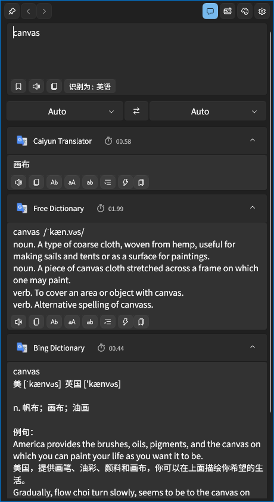
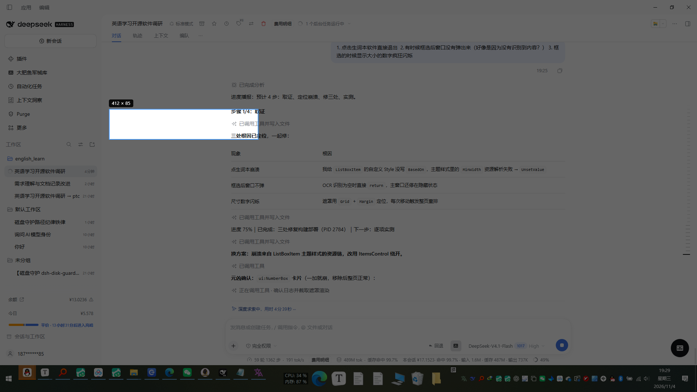
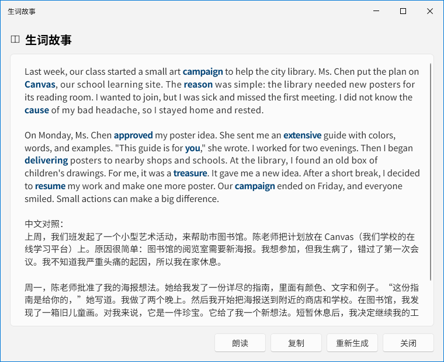

# English Learn

面向中文用户的英语学习桌面工具：**看到英文 → 立刻看懂 + 听到发音 + 顺手收进生词本**，再用 AI 把生词串成故事来复习。

基于 [STranslate](https://github.com/ZGGSONG/STranslate)（MIT）二次开发。



## 功能

### 划词翻译

- **划词气泡**：任意应用选中英文 → 出现气泡 → 鼠标悬停 0.3 秒自动弹翻译，全程不碰键盘
- **选中即翻译**：选中立刻取词并弹窗，适合连续阅读
- **快捷键划词**：默认 `Alt + D`

### 框选识别（OCR）

- **左键长按 450ms** 或按 **`Alt + Q`** → 全屏遮罩 → 拖框 → 识别文字 → 自动翻译
- 使用 Windows 内置 OCR，**离线、免密钥、零配置**
- 识别不到时自动做反色、放大重试



### 生词本

- 一键收词，自动补音标与英文释义（免密钥词典）
- 搜索、删除、导出 CSV
- **音标体系可切换**：KK（美式）/ IPA（国际）/ 两者对照，默认 KK

### AI 生词故事

- 取生词本里的词，用 AI 写成一段 150–220 词的小故事，目标词加粗高亮
- 附中文对照与理解题，可一键朗读、复制、重新生成
- 支持任意 OpenAI 兼容接口（含中转站），可拉取模型列表、单独配置代理



### 其他

- **自动朗读**：划词/框选后自动读原文，单词走有道真人音，整句走百度合成
- **翻译历史**：标题栏左右箭头在最近 20 个词之间切换，走缓存不重复请求
- **窗口置顶**：钉子按钮一键钉住，点窗口外也不会收起
- 朗读参数（发音源 / 口音 / 语速）与音标体系都在设置里直显，不需要点开某个服务

## 快速开始

### 环境要求

- Windows 10 1809 及以上（需要 Windows OCR）
- [.NET 10 SDK](https://dotnet.microsoft.com/download)
- Visual Studio 2022 17.10+ 或 Rider（可选）

### 构建

```powershell
cd vendor/STranslate-main/src

dotnet build STranslate/STranslate.csproj -c Release
```

产物在 `vendor/STranslate-main/src/.artifacts/Release/`，直接运行 `STranslate.exe`。

### 首次配置

1. **翻译服务**：设置 → 服务 → 文本翻译。内置彩云与必应词典可直接用；需要 key 的服务按提示填。
2. **朗读**：默认有道真人音（单词）+ 百度合成（整句），无需配置。
3. **AI 故事**（可选）：设置 → 常规 → AI 故事，填中转站地址、密钥、模型名，点「获取模型」拉列表。

运行时数据（配置、插件、日志）在程序目录下的 `PortableConfig/`，删除该目录即可恢复初始状态。

## 项目结构

```
english_learn/
├── vendor/STranslate-main/src/     # 主程序与插件源码（基于 STranslate）
│   ├── STranslate/                 # WPF 主程序
│   ├── STranslate.Plugin/          # 插件 SDK
│   └── Plugins/                    # 翻译 / 朗读 / OCR / 生词本插件
├── docs/                           # 项目文档与截图
├── toolchain/                      # 开发脚本（构建、部署、测试）
├── reports/                        # 调研与方案记录
└── LICENSE
```

### 本项目在原版基础上的改动

| 模块 | 改动 |
|---|---|
| 界面 | 删除 OCR 页/图片翻译/历史页/插件市场/网络页/首启向导等冗余入口 |
| 划词 | 新增气泡窗口、悬停触发、自动隐藏；与"选中即翻译"互斥 |
| 朗读 | 自建朗读插件（有道真人 + 百度合成），设置改为页面直显 |
| 生词本 | 从插件式改为内置 JSON 存储，新增词表页、搜索、导出、音标补全 |
| OCR | 新增左键长按 / `Alt+Q` 框选识别，接入 Windows 内置 OCR |
| 音标 | 新增 IPA → KK 转换与切换开关 |
| 历史 | 新增标题栏左右箭头导航（20 条） |
| AI | 新增生词故事生成（OpenAI 兼容接口） |

## 已知限制

- **只有 Windows**：重度依赖 WPF、Win32 鼠标钩子与系统 OCR
- **英式音标不做 KK 转换**：KK 是美式体系，英音保持 IPA 原样
- **AI 故事需要可用的 OpenAI 兼容接口**：国内直连 OpenAI 通常不可用，请自备中转站并配置代理

## 致谢

- [STranslate](https://github.com/ZGGSONG/STranslate) —— 本项目的基础（MIT）
- [iNKORE UI](https://github.com/iNKORE-NET/UI.WPF.Modern) —— WPF 控件库
- [ScreenGrab](https://github.com/ShareX/ScreenGrab) —— 屏幕框选
- [dictionaryapi.dev](https://dictionaryapi.dev/) —— 免密钥词典
- 有道 / 百度 / 必应 —— 发音与词典数据

## 许可证

[MIT](LICENSE)。保留上游 STranslate 的版权声明。
